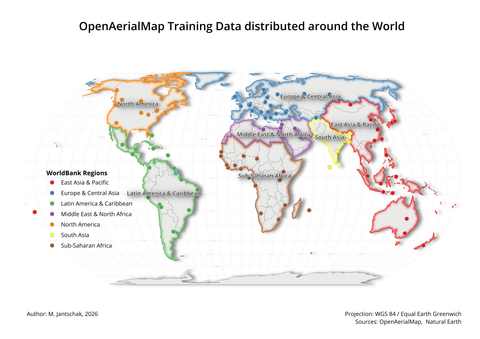
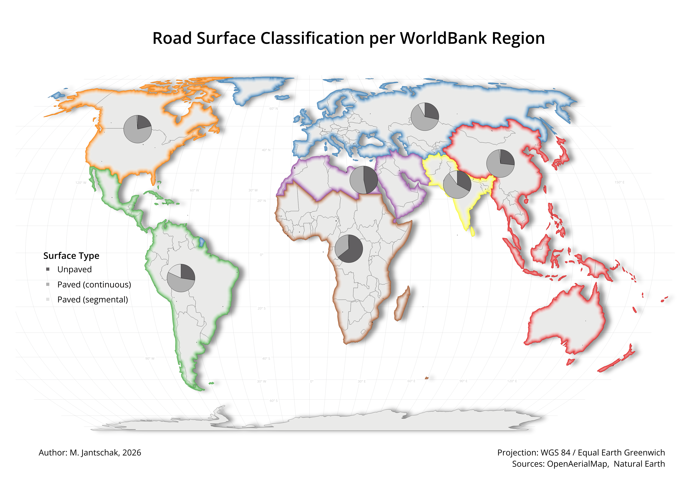
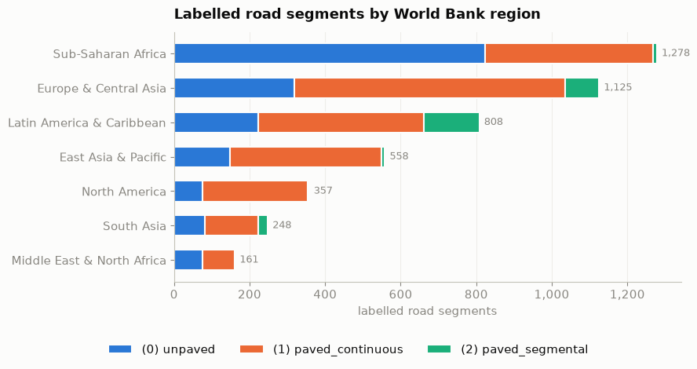
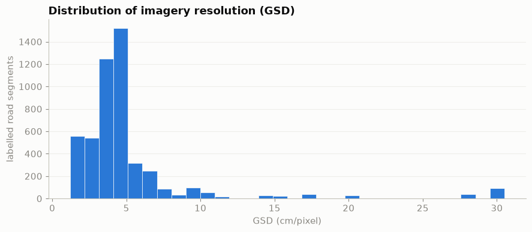
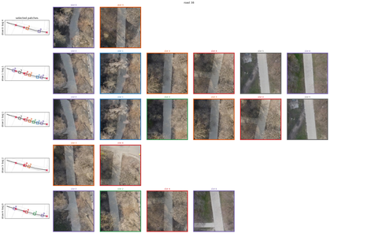
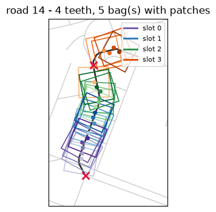
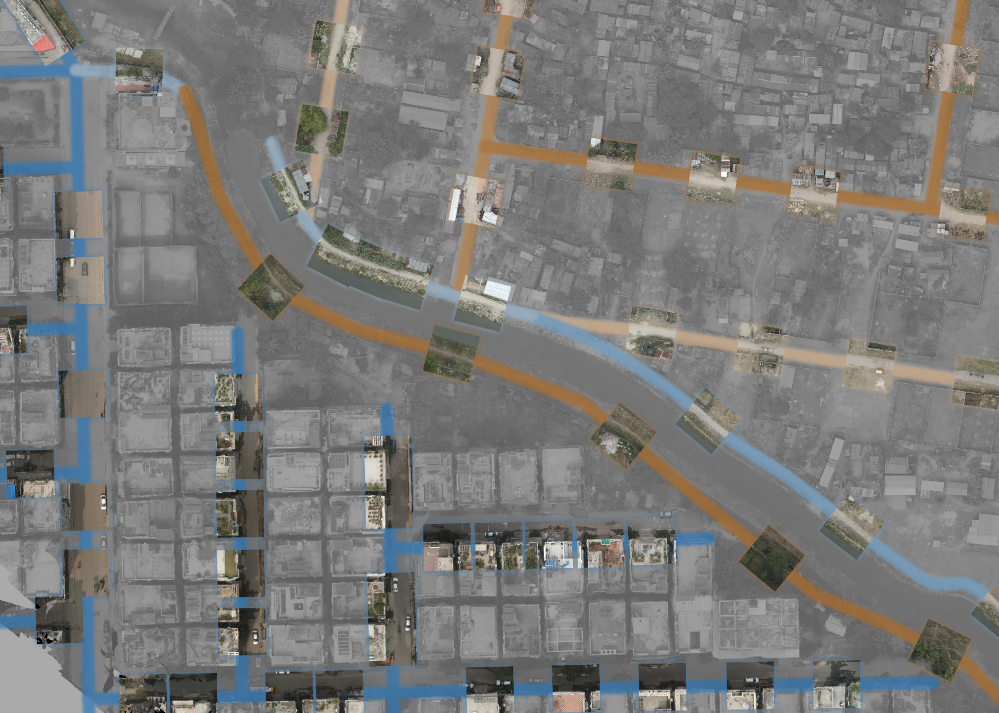
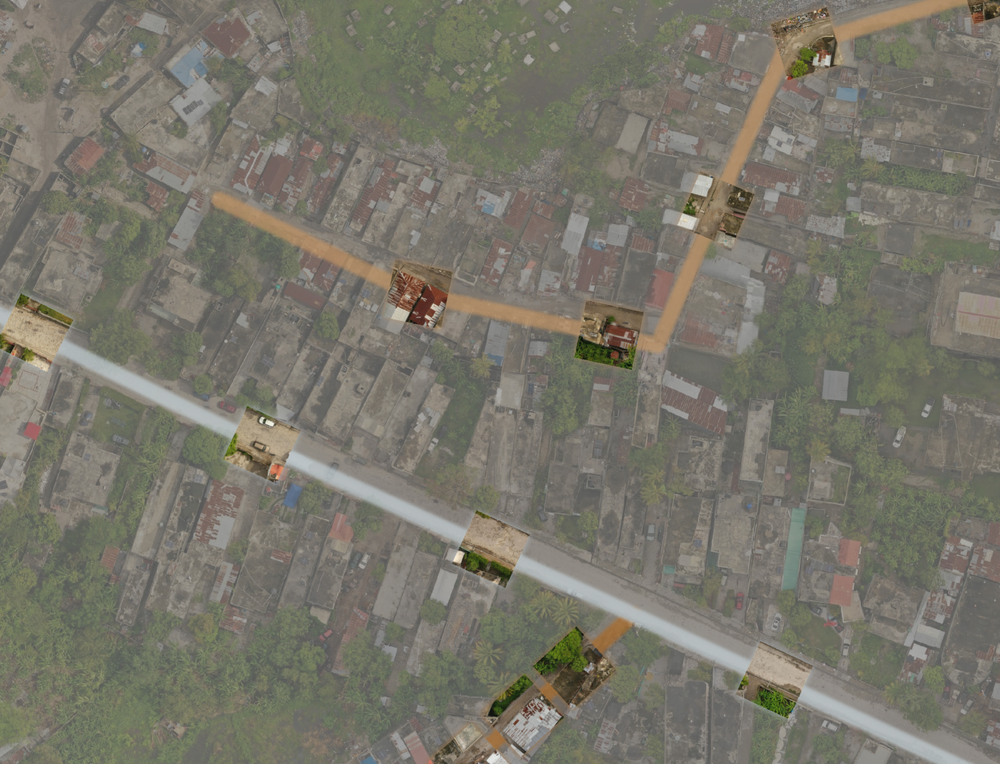
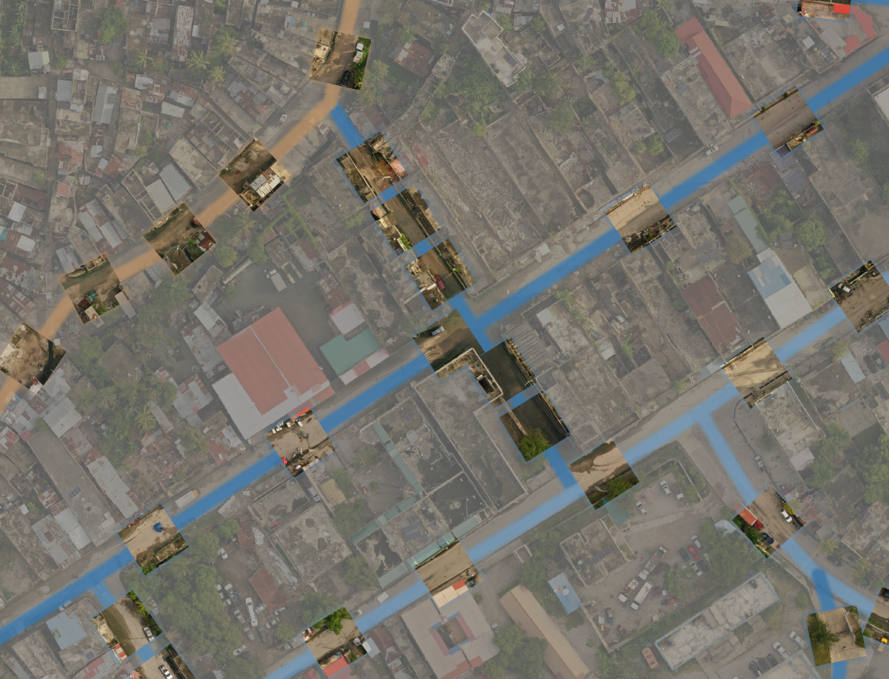

# SUSformer — Surface from UAV Scenery

SUSformer looks at an aerial image together with a road's geometry 
and decides whether that segement of road is **paved** or
**unpaved**. It is trained on a globally distributed catalogue of imagery
scenes from [OpenAerialMap](https://openaerialmap.org) (OAM). 
Training imagery is mostly captured by drones (UAV),
with a smaller share of high-resolution satellite imagery mixed in.
Testing shows SUSformer performs well on high-resolution satellite imagery too, even
though drone imagery is its primary design target.

## Classes

Roads are hand-labelled against a 3-class taxonomy:

| id | name               | meaning                                                                   |
|----|--------------------|----------------------------------------------------------------------------|
| 0  | `unpaved`          | unpaved surface (e.g. dirt, gravel, ground)                                |
| 1  | `paved_continuous` | paved, monolithic/jointless surface (e.g. asphalt, concrete)               |
| 2  | `paved_segmental`  | paved, made of discrete laid units (e.g. paving stones, sett, cobblestone) |

Currently, the classes `paved_continuous` and `paved_segmental` are combined
into one class `paved`.

## Intended use

- A decision-support signal for road/route planning where surface type
  affects vehicle accessibility
- SUSformer **classifies, it does not find roads**: it needs a road's
  geometry alongside the imagery. If your
  area of interest isn't well mapped yet, that's a gap to close upstream,
  not something SUSformer solves.
- Works best on OAM-style drone and high-resolution satellite imagery;
  low-resolution imagery will be harder for it to read reliably.

## Training data

- Trained on a **globally distributed catalogue of scenes from OpenAerialMap**,
  covering most regions of the world with some holes, where no usable scenes were available on OAM.
- Imagery is mostly **UAV (drone)** captures, with a smaller share of
  **high-resolution satellite** imagery also included.
- Roads are hand-labelled by a small team of contributors against the
  taxonomy above.
- **Scale**: 124 labelled scenes, **4,649 labelled road segments**.
- **Class balance**:

  | class              | count | share |
  |--------------------|------:|------:|
  | `unpaved`          | 1,784 | 38.4% |
  | `paved_continuous` | 2,600 | 55.9% |
  | `paved_segmental`  |   265 |  5.7% |

  Collapsed to the 2 classes the model actually trains on: **1,784 (38.4%)
  unpaved vs. 2,865 (61.6%) paved** — a real imbalance that training
  compensates for. If you finetune on a new region, expect to re-balance for
  your own label distribution rather than assuming this one transfers.

Most of the labelled scenes are from high-resolution (5cm and below) UAV imagery.
But also UAV and satellite imagery with a lower resolution were used. See at the distribution
below for more information.

## How the bagging approach works

Rather than judging a road from a single photo, SUSformer looks at several
close-up photos taken at different points along the same road segment, and
combines what it sees across all of them into one decision. A single photo
can be misleading: a tree or building can cover the road, the image may be blurred or distorted.
By looking at a handful of close-ups per
segment, and giving more weight to the clearest ones, the model builds a
more reliable picture than any one image could give on its own.

Each close-up covers a short stretch of road of roughly 15 metres and how
many close-ups a segment gets scales with its length, typically somewhere
between 2 and 7. During training, several different sets of close-ups are
generated per labelled road, so the same segment is seen from slightly
different positions along its length — making the model less sensitive to
exactly where along a road a photo happens to be taken.

## How we test reliability

We check how SUSformer's accuracy holds up under less-than-ideal conditions
— for example, when only one or two usable photos are available for a road,
or when the imagery is lower resolution than training imagery. This is meant
to answer: *if my imagery is patchier or coarser than what SUSformer trained
on, can I still trust its output?*

Numbers below are macro-balanced accuracy, mean ± std over 5-fold
cross-validation, each fold's score computed on its held-out
validation scenes:

| condition                         | accuracy        |
|------------------------------------|-----------------|
| normal use (full set of photos)    | 96.5% ± 0.7%    |
| only 1 photo per road              | 92.9% ± 0.8%    |
| only 2 photos per road             | 94.9% ± 0.6%    |
| only 4 photos per road             | 96.1% ± 0.7%    |
| imagery downsampled 2x             | 96.3% ± 1.1%    |
| imagery downsampled 4x             | 94.4% ± 1.9%    |
| imagery downsampled 8x             | 91.8% ± 1.7%    |
| imagery downsampled 16x            | 86.0% ± 2.8%    |

Macro AUROC under normal use: 99.5% ± 0.3%.

Takeaway: SUSformer is fairly robust to having fewer photos per road (even a
single photo only costs ~3.6pp of accuracy) and to moderate resolution loss,
but accuracy degrades noticeably once imagery is downsampled 8x or more —
treat its output with more caution on very low-resolution imagery.

## Examples

The following examples show predictions of the SUSformer. Brown colours show unpaved
and blue colours paved predictions. The hue indicates the certainty of the model for this prediction.

